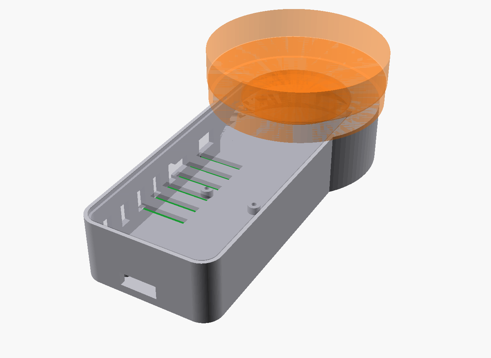
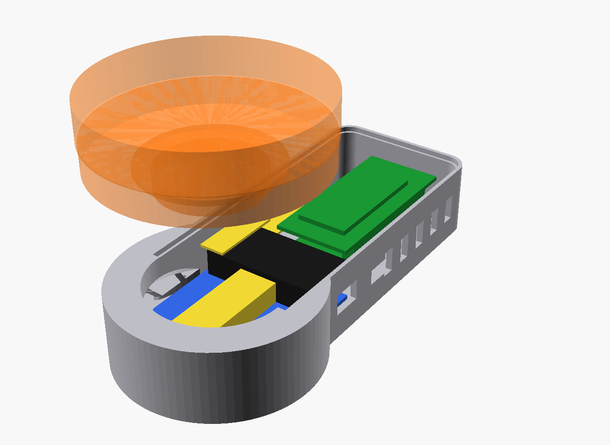
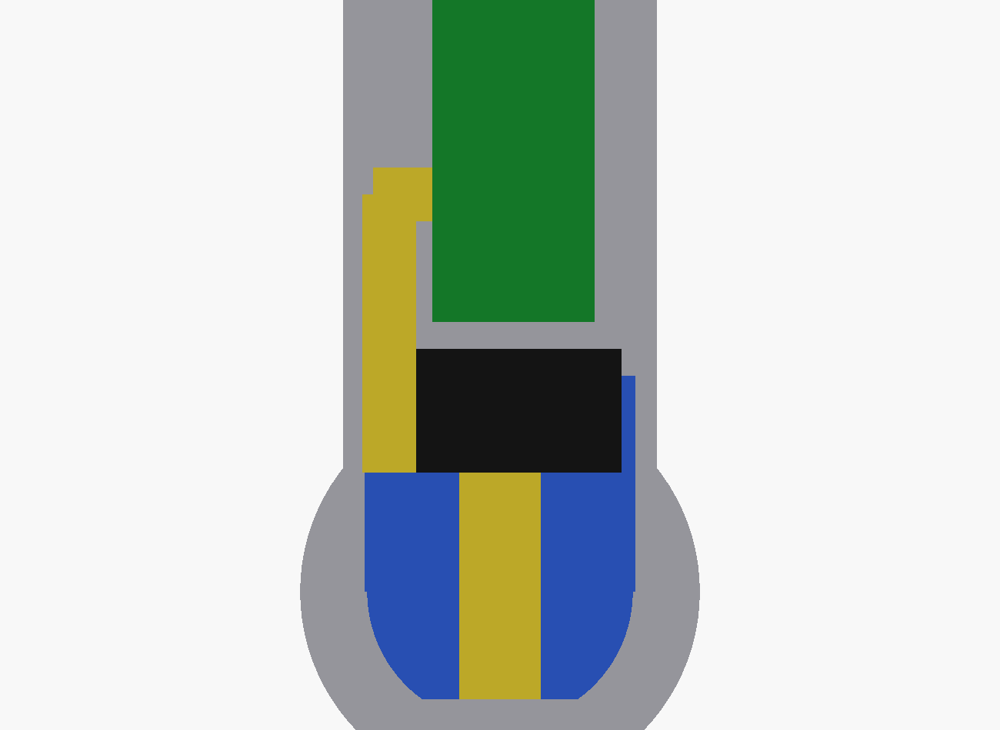
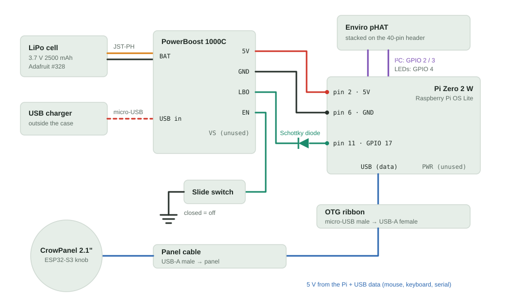

# Handheld controller

A handheld for exploring volumes without a mouse: the Elecrow CrowPanel 2.1"
rotary display is the knob, and a Raspberry Pi Zero 2 W in the handle hosts it,
runs on a LiPo, and carries an Enviro pHAT for motion sensing. The case design
(`case/brainsonify.scad`) and the knob's firmware live in
[cdrake/crowpanel-knob](https://github.com/cdrake/crowpanel-knob).

The case is a design, not yet a print. The pHAT stack height (11 mm) and the size
of the OTG plug and socket are estimates and should be measured before printing.

## Renders







Blue is the LiPo, yellow the OTG cable, black the PowerBoost, and green the Pi
with the pHAT on top. The panel's 48 mm rear disc drops into the pocket in the
head, and the 79 mm display rests on the head rim and the lid.

Inside, from the head to the end of the grip:

1. The LiPo lies flat on the floor, half under the panel.
2. The OTG socket, with the panel's USB-A plug seated in it, sits on the LiPo
   under the panel.
3. The PowerBoost lies across the handle on the LiPo. Its micro-USB charging
   port and a slide switch are in the side wall.
4. The Pi sits on M2.5 standoffs with the pHAT stacked on its header. Its ports
   face a 14 mm channel for the right-angle OTG plug, and the microSD slot is in
   the end wall.

Overall: 74 × 157 × 28 mm, about 52 mm tall with the panel.

## Parts

| Part | Notes |
|---|---|
| Elecrow CrowPanel 2.1" rotary display | ESP32-S3; appears as a USB mouse and keyboard, plus a serial port |
| Raspberry Pi Zero 2 W | Raspberry Pi OS Lite (64-bit) |
| Pimoroni Enviro pHAT | Stacked on the 40-pin header |
| Adafruit PowerBoost 1000C | 5.2 V boost with load-sharing charger; USB-A port not fitted |
| Adafruit #328 LiPo, 3.7 V 2500 mAh | 50 × 60 × 7.3 mm, JST-PH, protection circuit |
| StarTech UUSBOTGRA | 5 in right-angle micro-USB male to USB-A female OTG cable |
| Schottky diode (1N5817 or similar) | Keeps the PowerBoost's low-battery signal within the Pi's 3.3 V limit |
| Slide switch | Power switch on the PowerBoost's EN pin |

## Wiring



| From | To | Notes |
|---|---|---|
| LiPo JST-PH | PowerBoost battery jack | Adafruit cells match the PowerBoost's polarity; many other cells are reversed |
| USB charger | PowerBoost micro-USB | Through the side wall; charges while the device runs |
| PowerBoost `5V` | Pi pin 2 (5V) | 22 to 24 AWG, soldered to the underside of the header pin because the pHAT sits on top |
| PowerBoost `GND` | Pi pin 6 (GND) | Same |
| PowerBoost `EN` | Slide switch, other side to `GND` | Closed turns the output off; the battery still charges |
| PowerBoost `LBO` | Pi pin 11 (GPIO 17), through the diode | Band (cathode) toward LBO. LBO is pulled up to battery voltage, up to 4.2 V, which Adafruit warns is unsafe for 3.3 V logic; the diode only lets it pull the pin low |
| Pi micro-USB `USB` | OTG cable, then panel cable, then CrowPanel | The data port, not `PWR`; the panel runs from the Pi's 5 V rail |
| Pi 40-pin header | Enviro pHAT | I²C on GPIO 2 / 3 and LEDs on GPIO 4, which leaves GPIO 17 free |

The PowerBoost is rated about 1 A, and the Pi, panel, and pHAT together can
approach that at peaks. Keep the panel's Wi-Fi off and dim its backlight when idle.

## Pi setup

`/boot/firmware/config.txt`:

```
dtparam=i2c_arm=on
dtoverlay=gpio-shutdown,gpio_pin=17,active_low=1,gpio_pull=up
```

The overlay shuts the Pi down cleanly when LBO drops, below 3.2 V on the cell.
The slide switch cuts power instantly, so shut down before switching off to
protect the microSD card.

The Enviro pHAT's temperature sensor reads high when stacked on a Zero 2 W,
because heat from the Pi's processor soaks into it. The motion sensor is
unaffected.
